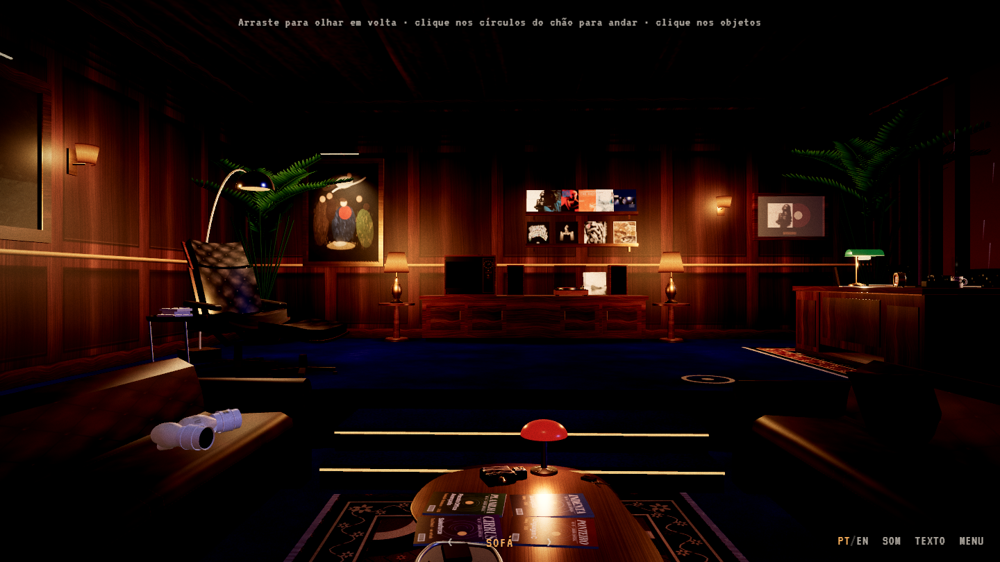
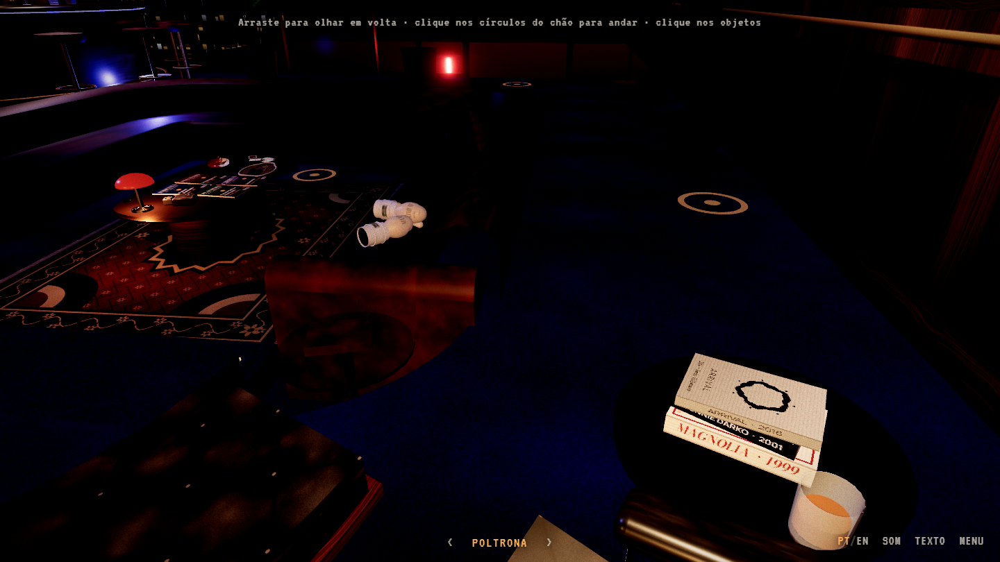
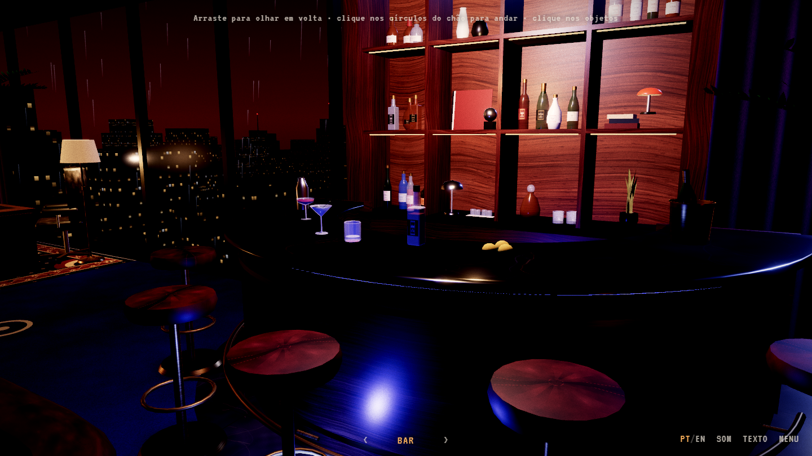
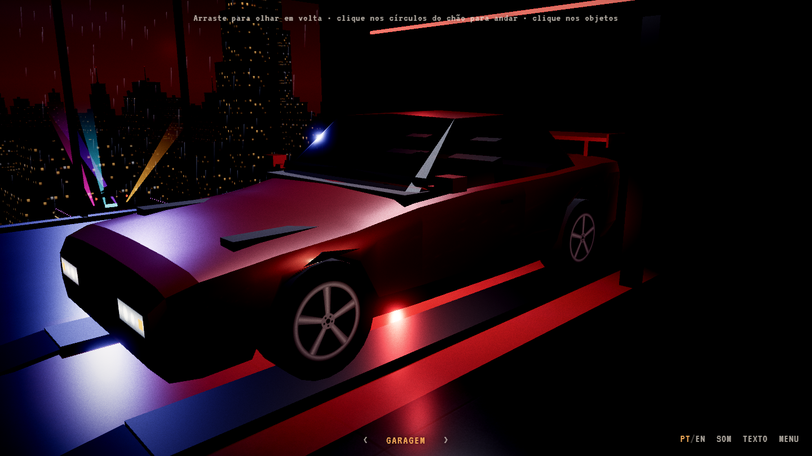

# Portfólio 3D — Raphael Scharf Passos

Uma cobertura de mafioso dos anos 80, numa noite de chuva, no clima de Max Payne 2 e dos jogos de PS2. Cada objeto da sala abre uma parte do portfólio: a TV mostra os projetos, o notebook conta quem eu sou, as revistas são os certificados, o toca-discos toca de verdade e, pela janela, a cidade anuncia os meus projetos.



> Em construção: falta o acabamento final. A especificação completa está em [docs/ESPECIFICACAO.md](docs/ESPECIFICACAO.md).

## O que tem em cada canto

| Lugar      | Objeto                          | O que abre                                                                                                                               |
| ---------- | ------------------------------- | ---------------------------------------------------------------------------------------------------------------------------------------- |
| Sala       | TV de tubo                      | Os projetos, um por canal, com vídeo, tecnologias e link                                                                                 |
| Sala       | Toca-discos e estante           | As músicas que eu gosto, tocando de verdade (capa, faixa, volume)                                                                        |
| Sala       | Revistas na mesa de centro      | Os certificados, cada um como capa de revista                                                                                            |
| Escritório | Notebook                        | Sobre mim, formação e experiência                                                                                                        |
| Escritório | Papéis na mesa                  | O currículo em PDF, para ler ou baixar                                                                                                   |
| Escritório | Gaveta do meio (sentado)        | Um segredo riscado no fundo                                                                                                              |
| Poltrona   | Livros na mesinha               | Meus filmes favoritos, com o que eu acho de cada um                                                                                      |
| Bar        | Garrafas                        | Um drink servido no balcão (whisky, martini ou negroni)                                                                                  |
| Janela     | A cidade                        | Anúncios do UniCar e da Automação de Frotas que levam ao canal certo da TV, cinema, clube de jazz, cassino, hotel e coberturas com festa |
| Garagem    | Carro (capô)                    | As skills: cada peça do motor é um grupo de tecnologias                                                                                  |
| Garagem    | Carro (porta ou chaves na mesa) | Entra no carro: o rádio tem os contatos nas estações (e-mail, LinkedIn, GitHub, currículo) e o porta-luvas guarda o currículo            |
| Garagem    | Faróis                          | Ligam e desligam; acesos, iluminam o chão até a sala                                                                                     |

Dá para olhar em volta arrastando o mouse (ou o dedo), andar clicando nos círculos do chão e trocar de lugar pelas setas da legenda. Quem prefere ler tem o **menu de texto**, com o portfólio inteiro em HTML, e tudo existe em português e inglês.

|                                                                    |                                                                    |
| ------------------------------------------------------------------ | ------------------------------------------------------------------ |
|       |  |
|                     |      |
|  |     |

## Tecnologias

- **React 18 + TypeScript + Vite**
- **three.js** com **React Three Fiber** e **drei**; pós-processamento com bloom, vinheta, contraste e granulado
- **GSAP** para a câmera e as animações, **Zustand** para o estado, **Howler.js** para a música, **i18next** para os idiomas
- **Vitest**, **ESLint** e **Prettier**

Todos os objetos são modelados no próprio código, em low poly no estilo PS2, com texturas pintadas em canvas. A exceção é o carro da garagem, o modelo do Lancer Evolution VIII em `public/models/car.glb` (veja os créditos).

## O que você precisa

- **Node.js 20.19 ou mais novo** (o projeto usa Vite 8) e npm
- Um navegador com WebGL 2 (Chrome, Edge, Firefox ou Safari recentes)
- Opcional, para os prints automáticos: Google Chrome ou Microsoft Edge instalado

## Como rodar

```bash
npm install
npm run dev
```

O site abre em `http://localhost:5173`.

| Comando                                      | O que faz                                        |
| -------------------------------------------- | ------------------------------------------------ |
| `npm run dev`                                | Servidor de desenvolvimento                      |
| `npm run build`                              | Confere os tipos e gera o site em `dist/`        |
| `npm run preview`                            | Serve o `dist/` para conferir o build            |
| `npm run test`                               | Testes (estado, câmera, revistas, player)        |
| `npm run lint`                               | ESLint sem avisos                                |
| `npm run format`                             | Prettier em tudo                                 |
| `npm run audio`                              | Renomeia e converte as músicas de `public/audio` |
| `npm run shots -- docs/prints/pasta home tv` | Tira prints em desktop e celular                 |

## Arquivos que não ficam no Git

Músicas e vídeos são pesados e têm direitos de terceiros, então ficam fora do repositório. Sem eles o site funciona: o disco aparece com o selo "em breve" e a TV mostra o print no lugar do vídeo.

| Pasta                   | O que vai nela                                                                                                                                                                     | Como usar                                                                                                                                                                                                                                              |
| ----------------------- | ---------------------------------------------------------------------------------------------------------------------------------------------------------------------------------- | ------------------------------------------------------------------------------------------------------------------------------------------------------------------------------------------------------------------------------------------------------ |
| `public/audio/`         | As faixas dos discos (`.mp3`, `.ogg`, `.wav` ou `.flac`)                                                                                                                           | Rode `npm run audio`: ele renomeia e converte para o nome que o site espera (lista em `src/content/tracks.ts`)                                                                                                                                         |
| `public/videos/`        | `unicar.webm` e `frotas.webm`, os vídeos que passam na TV                                                                                                                          | Basta copiar os arquivos com esses nomes                                                                                                                                                                                                               |

Em produção as músicas vêm de um bucket (Cloudflare R2). O endereço fica na variável `VITE_AUDIO_BASE_URL`; copie `.env.example` para `.env.local` e ajuste.

## Onde mudar o conteúdo

| Arquivo                           | Conteúdo                                                            |
| --------------------------------- | ------------------------------------------------------------------- |
| `src/content/pt.json` e `en.json` | Todos os textos do site, nos dois idiomas                           |
| `src/content/projects.ts`         | Projetos da TV (canal, tecnologias, link, print, vídeo)             |
| `src/content/certificates.ts`     | Certificados das revistas                                           |
| `src/content/tracks.ts`           | Discos e faixas do toca-discos                                      |
| `src/content/films.ts`            | Filmes dos livros da poltrona (as notas ficam nos JSON, em `films`) |
| `public/cv/`                      | Currículo em PDF                                                    |
| `public/textures/foto.webp`        | Foto do porta-retrato                                               |

## Estrutura

```
src/
  scene/      sala, escritório, bar, poltrona, janela, cidade, coberturas, chuva, luzes e efeitos
  objects/    TV, toca-discos, discos, revistas, notebook, gaveta, livros, drinks...
  textures/   texturas pintadas em canvas e materiais
  camera/     pontos de vista e planos de câmera
  ui/         menu de texto, ficha dos filmes, currículo, carregamento, idioma, volume
  content/    textos (pt.json, en.json) e dados
  audio/      player (Howler)
  store/      estado (Zustand)
scripts/      prints automáticos, preparo das músicas, compressão de modelos
docs/         especificação, planta e prints de cada etapa
```

Em desenvolvimento, `window.__scene` (estado) e `window.__three` (cena e câmera) ficam expostos no console, e o `scripts/screenshot.mjs` aceita variáveis como `SHOT_PRE`, `SHOT_CLICK` e `SHOT_EVAL` (veja o começo do arquivo).

## Créditos e direitos

Código e cena: Raphael Scharf Passos. Todos os direitos reservados.

Modelo do carro: "Mitsubishi Lancer Evolution VIII Low Poly", de [1313feodal](https://sketchfab.com/1313feodal), no Sketchfab (licença Free Standard). No site ele ganha pintura amarela, vidros, luzes, cambagem e o capô e a porta recortados para abrir.

As capas de discos, as músicas e os títulos de filmes pertencem aos seus donos e aparecem só como referência pessoal. Nomes de lugares e anúncios da cidade (Bella Napoli, Lucky 7, The Velvet Room, Orpheum) são inventados. As marcas de bebida e objetos citados aparecem em rótulos simples, sem logotipos.

---

# 3D Portfolio — Raphael Scharf Passos

An 80s mob-boss penthouse on a rainy night, in the mood of Max Payne 2 and PS2-era games. Every object opens a part of the portfolio: the CRT TV shows the projects (one per channel), the laptop tells who I am, the magazines are my certificates, the turntable really plays, the books by the armchair hold notes on my favorite films, and through the window the city advertises my projects (click a billboard to jump to its TV channel). In the garage, the car holds the skills under the hood and the contacts on the radio.

Everything is modeled in code, low poly with canvas-painted textures, with React Three Fiber, TypeScript and Vite. There is a plain-HTML text menu with the whole portfolio, in Portuguese and English.

**Requirements:** Node.js 20.19+ and npm. **Run:** `npm install` then `npm run dev`. Music (`public/audio`) and project videos (`public/videos`) are kept out of Git; without them the site still works. Texts live in `src/content/pt.json` and `en.json`.

Code and scene by Raphael Scharf Passos, all rights reserved. Album covers, songs and film titles belong to their owners.
