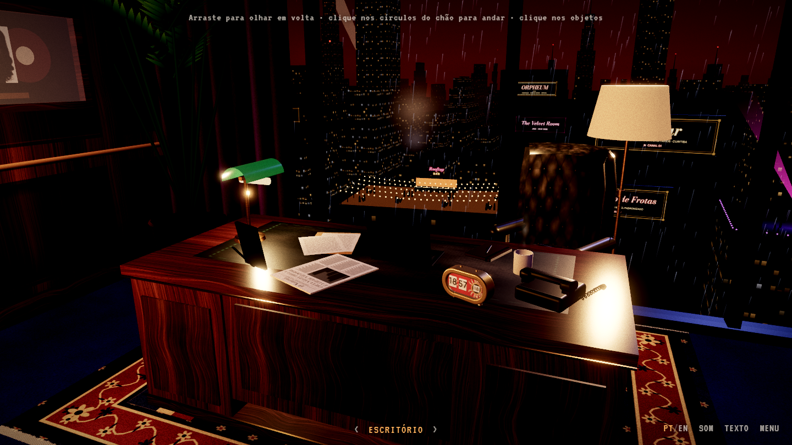
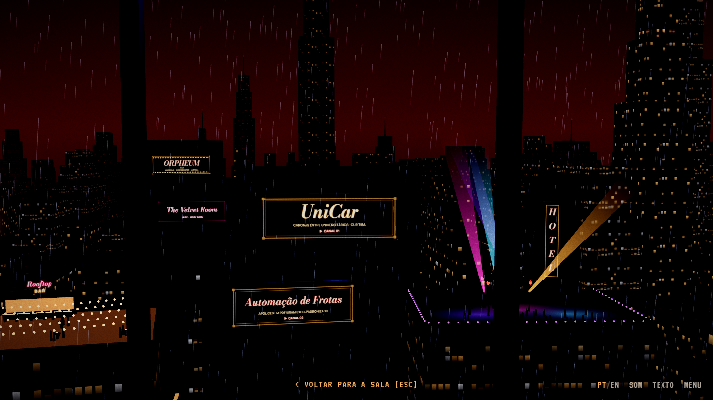
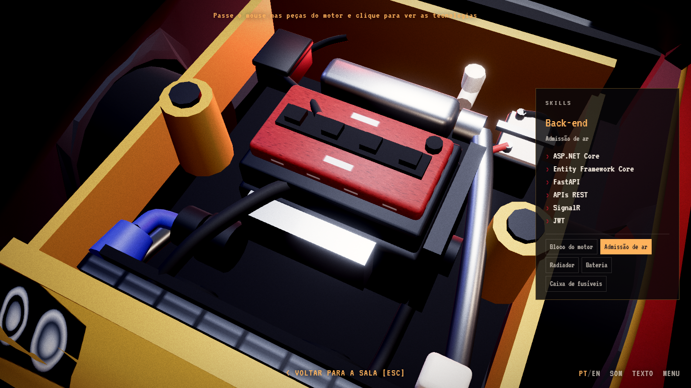

# Raphael Scharf — Portfólio 3D

**Acesse:** [raphaelscharf.vercel.app](https://raphaelscharf.vercel.app)

Uma cobertura dos anos 80 numa noite de chuva, em clima neo-noir, com Max Payne 2 e os jogos de PS2 como base. Em vez de uma página com seções, o portfólio é um lugar: cada objeto da sala abre uma parte dele.

## O que tem em cada canto

| Onde       | Objeto                     | O que mostra                                                           |
| ---------- | -------------------------- | ---------------------------------------------------------------------- |
| Sala       | TV de tubo                 | Os projetos, um por canal, com vídeo, tecnologias e repositório        |
| Sala       | Toca-discos                | As músicas que eu gosto, tocando de verdade                            |
| Sala       | Revistas na mesa de centro | Os certificados, cada um como capa de revista                          |
| Escritório | Notebook                   | Sobre mim, formação, experiência e idiomas                             |
| Escritório | Papéis na mesa             | O currículo em PDF                                                     |
| Poltrona   | Livros                     | Meus filmes favoritos e o que eu acho de cada um                       |
| Janela     | A cidade                   | Anúncios dos meus projetos, que levam ao canal certo da TV             |
| Garagem    | Capô do carro              | As skills: cada peça do motor é um grupo de tecnologias                |
| Garagem    | Porta do carro             | O contato: cada estação do rádio é um canal (e-mail, LinkedIn, GitHub) |

Quem prefere ler tem a **versão em texto** (botão "Texto"), com o portfólio inteiro em HTML. Tudo existe em português e inglês.

|                                                                    |                                                                 |
| ------------------------------------------------------------------ | --------------------------------------------------------------- |
|       |   |
|  |  |

## Como foi feito

Fiz este portfólio por vontade própria, para aprender 3D e criar algo diferente de um site comum.

- **Quase tudo modelado em código.** Móveis, objetos e a cidade são geometria escrita à mão com React Three Fiber, em estilo low poly. As texturas (madeira, couro, capas, letreiros) são pintadas em canvas quando o site abre, sem baixar imagens.
- **Cidade gerada.** Os prédios, as ruas, os carros andando e as janelas acesas saem de um gerador com semente fixa: a cidade é sempre a mesma. Ela é leve porque usa brilho pintado em vez de luzes de verdade.
- **Câmera de cinema.** As trocas de vista são cortes com fade, enquadradas pelo que precisa caber na tela, para funcionar de monitor largo a celular.
- **Áudio de verdade.** O toca-discos toca as faixas com fade e chiado de vinil. A chuva e os efeitos são sintetizados no navegador.
- **Acessível.** Tem uma versão em texto completa, navegação por teclado, endereço próprio para cada seção (#projetos, #skills…) e respeito a "reduzir movimento".
- **Testado e publicado.** TypeScript estrito, ESLint, Prettier e testes com Vitest. O site fica na Vercel.

**Tecnologias:** React, TypeScript, Three.js, React Three Fiber, drei, Zustand, GSAP, Howler.js, i18next, Vite, Vitest.

## Créditos

Código e cena: Raphael Scharf Passos. Todos os direitos reservados.

Modelo do carro: "Mitsubishi Lancer Evolution VIII Low Poly", de [1313feodal](https://sketchfab.com/1313feodal), no Sketchfab (licença Free Standard), com pintura, luzes e capô e porta recortados para abrir.

Capas de discos, músicas e títulos de filmes pertencem aos seus donos e aparecem só como referência pessoal. Os lugares e anúncios da cidade são inventados, exceto o Folks Pub Sertanejo, uma homenagem a um bar de Curitiba.

---

# Raphael Scharf — 3D Portfolio

**Visit:** [raphaelscharf.vercel.app](https://raphaelscharf.vercel.app)

An 80s penthouse on a rainy night, in a neo-noir mood, built on Max Payne 2 and PS2-era games. Instead of a page with sections, the portfolio is a place: every object opens a part of it. The CRT TV shows the projects, the laptop tells who I am, the turntable really plays, the car's engine holds the skills and its radio holds the contacts. There is also a full text version, in Portuguese and English.

I built it on my own, to learn 3D and make something different. Almost everything is modeled in code with React Three Fiber and TypeScript, with canvas-painted textures and a procedurally generated city.

Code and scene by Raphael Scharf Passos, all rights reserved. Car model by 1313feodal (Sketchfab, Free Standard license).

Publicar: `npm run deploy` (com public/audio e public/videos no lugar).
