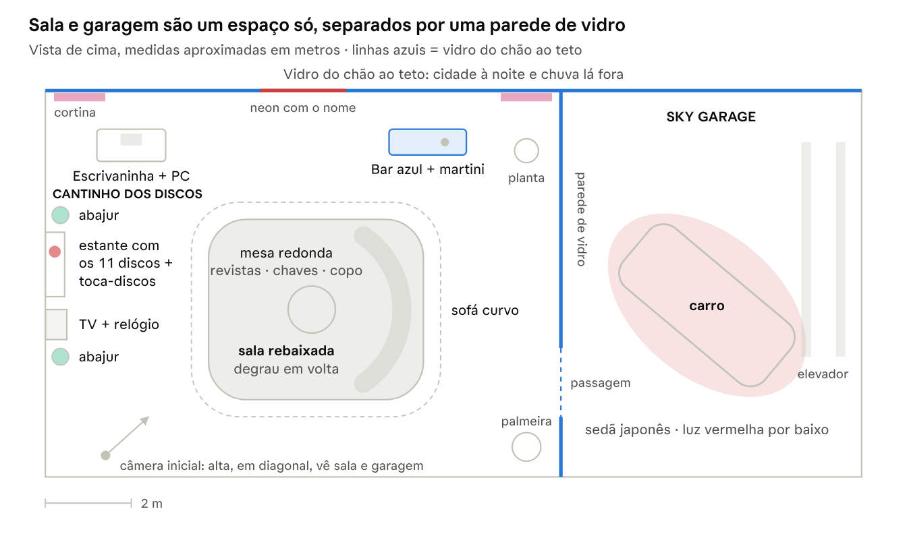

# Portfólio 3D — Especificação para o Fable

2026-11-16 · Raphael

Este documento é a fonte única para o Fable construir o portfólio 3D do Raphael. Ele complementa o documento Portfólio 3D — Conceito, que guarda a história das decisões.

## Decisões fechadas

O site é uma cobertura de mafioso dos anos 80 em 3D, onde cada objeto abre uma parte do portfólio e o conteúdo aparece no próprio objeto.

| Tema | Decisão |
| --- | --- |
| Idioma | Português como padrão e inglês completo, com botão PT/EN sempre visível; o idioma escolhido fica salvo no navegador |
| Música | Arquivos próprios (.ogg com .mp3 de reserva), tocados com Howler.js; nada de player do YouTube ou Spotify |
| Arquivos de áudio | Fornecidos pelo Raphael. Ficam fora do Git; em produção vão para um bucket Cloudflare R2 gratuito. O código lê a URL base de uma variável de ambiente |
| Repositório | Novo repositório público `portfolio` no GitHub rfz611, separado dos outros projetos |
| Pasta local | `C:\Users\Raphael\Documents\rfz\portfolio`, conectada ao chat do Fable |
| Hospedagem | Vercel, publicando a cada push na branch main |
| Endereço | Começa no endereço gratuito da Vercel; domínio próprio entra depois de pronto, sem mudar código |
| Conteúdo das telas | HTML real dentro dos objetos 3D (TV, PC, rádio, revistas), nunca painel lateral |
| Fallback | Menu de texto e versão leve para celular e para quem prefere não explorar o 3D |
| Proibido | Personagens, logos de marcas, emblemas de carro e dados reais de clientes. O Fable não baixa nem cria músicas e capas de álbum: o Raphael coloca os arquivos dele |

## Stack técnica

React Three Fiber com TypeScript e Vite: o padrão atual para sites 3D interativos, com HTML real dentro da cena.

| Camada | Pacote | Uso |
| --- | --- | --- |
| Base | Vite + React 18 + TypeScript | Projeto e build |
| 3D | three, @react-three/fiber | Cena e renderização |
| Utilitários 3D | @react-three/drei | Carregar .glb, `Html` dentro dos objetos, `Environment`, `MeshReflectorMaterial`, `useProgress` |
| Acabamento | @react-three/postprocessing | Bloom, N8AO (sombreamento de contato), vinheta, granulado, profundidade de campo leve |
| Animação | GSAP | Câmera entre objetos, capô, leque dos discos, revistas |
| Estado | Zustand | Objeto aberto, disco tocando, volume, idioma, qualidade |
| Áudio | Howler.js | Música e sons de ambiente (chuva, chiado do vinil, cliques) |
| Idiomas | i18next + react-i18next | Textos em `pt.json` e `en.json` |
| Modelos | gltf-transform (CLI) | Compressão Meshopt e texturas KTX2 |
| Qualidade | ESLint, Prettier, Vitest | Padrão de código e testes do estado e do player |
| Publicação | Vercel + Cloudflare R2 | Site e arquivos de áudio |

Estrutura de pastas:

```
portfolio/
  public/
    models/        arquivos .glb comprimidos
    textures/      capas de discos e revistas, telas, cidade
    audio/         só em desenvolvimento (fora do Git)
    og-image.jpg   imagem de compartilhamento
  src/
    scene/         Room, RecordCorner, Desk, Lounge, Garage, City, Rain, Lights, Effects
    objects/       Turntable, CrtTv, RetroPc, Magazines, CarKeys, Car, Radio, Engine
    ui/            Loader, TextMenu, LangToggle, VolumeControl, BackButton
    content/       pt.json, en.json, projects.ts, skills.ts, tracks.ts, certificates.ts
    audio/         player.ts (Howler)
    store/         useScene.ts (Zustand)
    camera/        shots.ts (posições de câmera)
  scripts/         compress-models.mjs
  .env.example     VITE_AUDIO_BASE_URL
```

## Direção de arte

Cobertura de mafioso nos anos 80, à noite e com chuva, no visual de um jogo de PS2: modelos low poly com texturas pintadas e luz "assada" na textura, apresentados com luz e pós-processamento modernos (as regras estão em Low poly no estilo PS2, logo abaixo). Referência principal do ambiente: Max Payne 2 (interior noir escuro, luz amarela de abajur, móveis simples com textura boa). Referência principal do carro e da garagem: Need for Speed Underground 2 (lataria com reflexo, neon, noite). Apoio: Mafia, Scarface, Miami Vice, Hitman: Blood Money, Drive.

| Papel | Cor |
| --- | --- |
| Base noturna (carpete, céu, sombras) | #0B1030 |
| Mogno envernizado | #4A1A0E |
| Couro vinho / couro marrom | #5C0F16 / #3B1F14 |
| Latão dourado | #B8893A |
| Cortinas roxas | #3A1450 |
| Luz âmbar dos abajures | #FFB35C |
| Neon vermelho / azul do bar | #D0142C / #2D4BFF |
| Texto da interface | #EFE6DA |

Tipografia da interface (Google Fonts):

- **Bodoni Moda itálico**: nome e títulos grandes, como cartaz de filme.
- **Manrope**: textos e menus.
- **VT323**: tudo que aparece em telas antigas (TV, PC, rádio, relógio).

Luz e acabamento:

- Quase tudo no escuro; âmbar baixo dos abajures, azul do bar, cidade pela janela e vermelho vindo da garagem.
- Bloom só nas fontes de luz e no neon; reflexo no piso da garagem, no vidro e no verniz da mesa; granulado de filme leve; vinheta.
- Chuva escorrendo no vidro e caindo lá fora.
- Proibido: filtro de pixel pesado, caixas lisas como móveis, cores fora da paleta e qualquer cara de jogo indie: nada de low poly fofo com cores chapadas e sem textura.

### Low poly no estilo PS2

O alvo é PS2, não PS1: formas simples e facetadas com texturas bem pintadas, como Midnight Club 3, Need for Speed Underground 2 e Max Payne 2. Os defeitos do PS1 (textura tremendo, vértices pulando) não entram, porque deixam o site com cara de erro.

- **Geometria:** poucos polígonos, silhueta limpa, quinas visíveis. Curvas importantes (sofá, mesa redonda, disco, farol) com segmentos suficientes para não parecer quadradas: 24 a 32 lados.
- **Texturas:** 512 px para objetos pequenos e 1024 px para carro, sofá, estante e bar. Detalhe pintado na textura (costura do couro, veio do mogno, grade do alto-falante), não modelado.
- **Luz assada:** sombra e oclusão de cada móvel vêm assadas na textura no Blender (bake). A luz em tempo real só acrescenta o âmbar dos abajures, o azul do bar e o vermelho da garagem.
- **Sombreamento:** flat ou suave por grupo de faces, nunca "massinha" derretida, que é o defeito típico dos modelos de IA.
- **Telas:** TV, monitor, rádio e relógio têm a tela como um plano separado e vazio no modelo. O conteúdo entra pelo código (HTML ou textura ao vivo), com vidro curvo, scanlines leves e brilho por cima. Por isso trocar o modelo nunca quebra o conteúdo.
- **Acabamento moderno por cima:** bloom, reflexo no piso e no vidro, granulado e vinheta. É isso que transforma "jogo velho" em "remaster bonito".

### Imagens de referência

As imagens do Pinterest que o Raphael separou ficam em docs/referencias no repositório, e o Fable olha para elas antes de cada fase de visual.

| Imagem | O que ela define |
| --- | --- |
| Cantinho do vinil com TV de tubo e luz âmbar | Cantinho dos discos: estante baixa, toca-discos, TV, abajures, disco vermelho |
| Cobertura anos 80 | Carpete azul, mogno, couro, palmeiras, sofá curvo, vidro do chão ao teto |
| Carro estilo Miami Vice e jogos de corrida | Clima da garagem e luz vermelha por baixo do carro |

## Planta da cena e câmeras

Um andar só: a sala de vidro à esquerda e a sky garage à direita, separadas por uma parede de vidro. Ninguém sobe nem desce; a câmera atravessa o vidro.



*planta da cobertura · sala 12 × 9 m, garagem 7 × 9 m*

Teto de 3,4 m. O cantinho dos discos fica na parede esquerda, de frente para o sofá curvo. A câmera inicial, alta no canto de baixo, vê o cantinho de três quartos, a cidade ao fundo e o carro pelo vidro à direita.

Como a garagem funciona: não há tela de carregamento nem "virar" para outra cena. É tudo um modelo só; o carro já aparece pelo vidro desde o primeiro plano. Ao clicar no carro ou nas chaves, a câmera desliza pela passagem da parede de vidro até o carro, e o botão Voltar faz o caminho de volta. Também há um atalho "Garagem" no menu de texto.

| Plano | Enquadramento | Quando |
| --- | --- | --- |
| Inicial | Diagonal alta, sala inteira e o carro aparecendo pelo vidro | Ao abrir e ao voltar |
| Discos | Frontal no cantinho, toca-discos no terço superior | Clique na estante ou no toca-discos |
| TV | Frontal, tela ocupando cerca de 60% da largura | Clique na TV |
| PC | Frontal, monitor ocupando a tela inteira | Clique no PC |
| Mesa | De cima, levemente inclinada, revistas no centro | Clique nas revistas |
| Carro (fora) | Diagonal frontal, capô em destaque | Clique no carro |
| Motor | De cima do capô aberto | Clique no capô |
| Interior | Banco do motorista olhando o painel e o rádio | Clique nas chaves ou na porta |
| Janela | Olhando a cidade e o neon com o nome | Clique na janela |

Transições de câmera: 1,2 a 1,6 s, curva suave (power3.inOut), sem atravessar móveis. Na câmera inicial, o mouse move a vista de leve (parallax de até 3 graus).

## Interações objeto por objeto

Regra geral: passar o mouse acende o objeto (contorno âmbar sutil e um rótulo curto em VT323); clicar leva a câmera até ele e o conteúdo aparece nele. Um botão "Voltar para a sala" e a tecla Esc sempre retornam ao plano inicial.

| Objeto | Seção | Comportamento |
| --- | --- | --- |
| Neon com o nome, na janela | Início | Plano da janela; aparece nome, título, uma frase e os botões Baixar currículo e Ver projetos |
| TV de tubo | Projetos | Liga com chiado e linha horizontal (0,6 s). Mostra o canal 01. Botões na própria TV (◀ CH ▶) trocam o canal, com chiado curto. Cada canal: nome, print do projeto, 3 linhas de descrição, tecnologias e link. Nunca troca sozinha |
| PC anos 2000 | Sobre mim | Tela liga com o som de inicialização. Área de trabalho retrô original (sem imitar o Windows) com ícones: sobre_mim.txt, Formação, Experiência, Idiomas. Duplo clique abre janelas arrastáveis dentro do monitor. O PC pode virar um notebook depois: a tela é um componente separado do modelo, então trocar o .glb não mexe no conteúdo |
| Revistas | Certificados | Empilhadas na mesa. Passar o mouse faz a de cima deslizar e revelar a seguinte. Clique abre a revista em primeiro plano: capa com o nome do certificado, instituição e ano. Nomes de revista inventados |
| Toca-discos e estante | Discos | A estante guarda as 10 capas da tabela de música, com Clássicos numa prateleira e Rap na outra; Raining but It's Ok já está no prato. Os discos saem da estante em leque na frente da câmera. Clique: o disco voa até o prato, a agulha desce, a faixa começa com fade de 2 s. Um cartão pequeno mostra capa, faixa e artista, com pausar, próximo e volume. O disco gira enquanto toca |
| Chaves na mesa | Contato | As chaves balançam e tilintam; a câmera atravessa o vidro até o carro, a porta abre e a vista entra no banco do motorista |
| Rádio do carro | Contato | Visor em VT323 vermelho. Girar o dial (arrastar, roda do mouse ou setas) passa pelas estações 88.1 E-mail, 91.5 LinkedIn, 97.3 GitHub, 101.9 Currículo, com chiado entre elas. Botão OK abre o link ou copia o e-mail |
| Porta-luvas | Currículo | Abre e mostra o PDF do currículo para baixar |
| Capô | Skills | Abre com animação. Cada peça do motor é um grupo de tecnologias; passar o mouse acende a peça e mostra o nome; clicar mostra as tecnologias do grupo |
| Faróis | Extra | Liga e desliga; aceso, ilumina a sala pelo vidro |
| Relógio digital | Extra | Fica no rack da TV, com números vermelhos em VT323, e mostra a hora real de quem visita |
| Bar azul com martini | Extra | Balcão de mogno com neon azul por baixo, garrafas atrás e uma taça de martini com azeitona em cima. Passar o mouse faz o gelo do copo da mesa tilintar baixinho; não abre seção |

Peças do motor e grupos de skills: bloco do motor = Linguagens; admissão de ar = Back-end; radiador = Front-end e mobile; bateria = Bancos de dados; caixa de fusíveis = Ferramentas.

## Música

Player próprio com Howler.js: suporta .ogg com reserva em .mp3, fade nativo, controle de volume e streaming de arquivos grandes, funcionando igual em todos os navegadores.

- **Nada toca sozinho.** O som começa só no primeiro clique do visitante (regra dos navegadores e da proposta).
- **Volume ambiente:** padrão de 35%, entrada com fade de 0 a 35% em 2 s, nunca acima de 60% mesmo no máximo do controle. O volume se regula no próprio toca-discos: um botão giratório de latão ao lado do prato (arrastar, roda do mouse ou setas), repetido no cartão do disco. Botão de mudo sempre visível no canto da tela; volume e mudo ficam salvos no navegador.
- **Faixa inicial:** Raining but It's Ok fica no prato quando a página abre, esperando o clique.
- **Carro:** ao entrar no carro, o áudio troca com crossfade para as faixas de garagem (Jukebox Joints e E. Coli) saindo do rádio; ao sair, volta para o toca-discos.
- **Ambiente** quase imperceptível: chuva em loop a 4% (só se nota quando a música para, sem trovões) e chiado de vinil a 5% enquanto um disco toca. O ambiente de verdade é a música.
- **Formato dos arquivos:** .ogg (Opus, 96 kbps) + .mp3 (128 kbps) de cada faixa, nomeados pelo `id` da tabela. Capas em .webp 512 × 512.
- **Origem:** `VITE_AUDIO_BASE_URL` aponta para `/audio` no desenvolvimento e para o bucket R2 em produção. Se um arquivo não existir, o disco aparece com o selo "em breve" e o resto do site segue funcionando.

| id        | Lado da estante | Artista                         | Faixa                   |
| --------- | --------------- | ------------------------------- | ----------------------- |
| raining   | No prato        | dublon, Tour-Maubourg, manon    | Raining but It's Ok     |
| pearls    | Clássicos       | Sade                            | Pearls                  |
| crime     | Clássicos       | Sade                            | Is It a Crime           |
| eyes      | Clássicos       | Billy Idol                      | Eyes Without A Face     |
| oldhouse  | Clássicos       | The Smiths                      | Back to the Old House   |
| exitmusic | Clássicos       | Radiohead                       | Exit Music (For A Film) |
| roads     | Clássicos       | Portishead                      | Roads                   |
| flights   | Rap             | Drake                           | Flight's Booked         |
| atm       | Rap (fundo)     | Don Toliver                     | ATM                     |
| jukebox   | Rap (fundo)     | A$AP Rocky, Joe Fox, Kanye West | Jukebox Joints          |
| ecoli     | Rap (fundo)     | The Alchemist, Earl Sweatshirt  | E. Coli                 |

Os arquivos de áudio e as capas são colocados pelo Raphael, todos juntos em public/audio e com o nome que vierem. O Fable identifica cada um, renomeia pelo id da tabela, converte para .ogg e move as capas para public/textures/covers. O Fable não baixa músicas nem capas e mantém `public/audio` no .gitignore.

## Conteúdo do site

Texto base em português; o Fable traduz para o inglês em `en.json`, com tom natural de portfólio, e o Raphael revisa. Nada além disto pode ser inventado.

**Início.** Raphael Scharf Passos · Estudante de Engenharia de Software · Curitiba, PR. Frase: "Construo back-ends em C# e Python e gosto de transformar trabalho manual em sistema." Status: procurando estágio em TI, à tarde, presencial ou híbrido em Curitiba, ou remoto.

**Projetos (canais da TV).**

| Canal | Projeto | Descrição | Tecnologias | Link |
| --- | --- | --- | --- | --- |
| 01 | UniCar | Aplicativo de caronas para universitários de Curitiba. API com login JWT e confirmação pelo e-mail da faculdade, posição do motorista e chat em tempo real, rotas e preço com Google Maps, testes de integração | C#, ASP.NET Core 8, Entity Framework Core, PostgreSQL, SignalR, React Native, TypeScript, xUnit | github.com/rfz611/unicar-app |
| 02 | Automação de Frotas | Sistema interno para uma corretora de seguros de Curitiba: lê apólices de frota em PDF de várias seguradoras, extrai os veículos e gera o Excel padronizado, com revisão de pendências, histórico e versões | Python, FastAPI, pdfplumber, openpyxl, Next.js, TypeScript | Repositório público de demonstração (link a definir) |

Prints dos projetos: `public/textures/projects/` (o Raphael fornece; os do Frotas usam só dados fictícios).

**Sobre mim (PC).**

- sobre_mim.txt: "Moro em Curitiba e estudo de manhã. Gosto de entender como uma operação funciona por dentro e de cortar o trabalho repetitivo dela."
- Formação: Engenharia de Software, Universidade Positivo, 2º ano, formatura prevista em 2028. Técnico em Análise e Desenvolvimento de Sistemas, SENAI, 2024.
- Experiência: Suporte técnico autônomo no Biobanco (2024–2025): manutenção de computadores, diagnóstico de hardware e software, atendimento aos usuários do laboratório.
- Idiomas: Português nativo; Inglês básico, estudando para Cambridge; Espanhol básico; Italiano iniciante.

**Certificados (revistas).** Python Avançado, Udemy, 2026 · Linguagem C, Udemy, 2025 · Pacote Office Avançado, Fundação Bradesco, 2026 · Salesforce (em estudo, Trailhead).

**Skills (motor).** Linguagens: C#, Python, TypeScript, SQL, C. Back-end: ASP.NET Core, Entity Framework Core, FastAPI, APIs REST, SignalR, JWT. Front-end e mobile: React Native (Expo), Next.js, React, Tailwind CSS. Bancos de dados: PostgreSQL, MySQL, SQLite. Ferramentas: Git, GitHub, xUnit, Visual Studio, VS Code.

**Contato (rádio).** E-mail raphaspassos@gmail.com · LinkedIn linkedin.com/in/raphaelscharf/ · GitHub github.com/rfz611 · Currículo em PDF (`public/cv/`, versões PT e EN). Telefone não aparece no site.

## Modelos .glb

O Fable modela todos os objetos no próprio código, já na qualidade final PS2: geometria low poly feita à mão e texturas pintadas em canvas (veio do mogno, couro, grade, etiquetas), com os limites de triângulos da tabela. Não são caixas provisórias: o site precisa ficar pronto e bonito sem nenhum arquivo externo. O carro recebe o maior cuidado: silhueta do carro da referência, rodas com aro, faróis, vidros escuros e lataria com reflexo. Modelos .glb feitos numa IA de 3D são só uma melhoria opcional para depois: se existir em public/models um arquivo com o nome da tabela, o site usa ele no lugar do modelo do código.

| Arquivo | Objeto | Medida aprox. (L × A × P, m) | Partes separadas exigidas | Triângulos (máx.) | Textura |
| --- | --- | --- | --- | --- | --- |
| car.glb | Carro esportivo japonês anos 2000 com a forma do carro dourado da imagem de NFS Underground 2 que o Raphael escolheu, em outra cor (a definir), sem emblemas | 4,40 × 1,45 × 1,75 | capô, porta do motorista, porta-luvas, faróis, rodas, rádio (visor vazio) | 15 mil | 1024 px |
| engine.glb | Peças do motor | cabem sob o capô | bloco, admissão, radiador, bateria, caixa de fusíveis | 1,5 mil cada | 512 px |
| car_lift.glb | Elevador de carro | 2,40 × 0,20 × 5,00 | — | 2 mil | 512 px |
| record_shelf.glb | Estante baixa de mogno | 1,50 × 1,00 × 0,45 | duas prateleiras (Clássicos e Rap) | 2 mil | 1024 px |
| turntable.glb | Toca-discos | 0,45 × 0,15 × 0,35 | prato, braço, tampa, botão de volume | 4 mil | 512 px |
| vinyl.glb / sleeve.glb | Disco e capa (usados 11×) | 0,31 de diâmetro / 0,32 × 0,32 | rótulo do disco e frente da capa como planos para textura | 500 cada | 512 px |
| crt_tv.glb | TV de tubo | 0,70 × 0,55 × 0,50 | tela (plano vazio), botões | 3 mil | 512 px |
| tv_rack.glb | Rack baixo da TV | 0,90 × 0,45 × 0,45 | — | 1 mil | 512 px |
| clock.glb | Relógio digital | 0,20 × 0,08 × 0,08 | visor (plano vazio) | 400 | 256 px |
| lamp.glb | Abajur (usado 2×) | 0,35 × 0,70 × 0,35 | cúpula | 1,5 mil | 512 px |
| sofa_curved.glb | Sofá curvo de couro | 3,20 × 0,80 × 1,80 | — | 6 mil | 1024 px |
| armchair.glb | Poltrona | 0,90 × 0,90 × 0,90 | — | 3 mil | 512 px |
| coffee_table.glb | Mesa redonda | 1,10 de diâmetro × 0,42 | tampo | 2 mil | 512 px |
| magazine.glb | Revista (usada 4×) | 0,22 × 0,01 × 0,29 | capa (plano para textura) | 200 | 512 px |
| car_keys.glb | Chaves | 0,08 × 0,02 × 0,12 | — | 800 | 256 px |
| glass.glb / ashtray.glb | Copo de uísque com gelo e cinzeiro | escala real | gelo | 600 cada | 256 px |
| bar.glb | Balcão do bar | 1,80 × 1,10 × 0,60 | faixa do neon azul | 4 mil | 1024 px |
| bar_bottles.glb | Garrafas atrás do balcão | conjunto de 6 | — | 2 mil | 512 px |
| martini.glb | Taça de martini com azeitona | escala real | — | 600 | 256 px |
| palm.glb / monstera.glb | Plantas | 1,80 / 1,10 de altura | — | 3 mil / 2 mil | 512 px |
| desk.glb | Escrivaninha | 1,60 × 0,76 × 0,75 | — | 2 mil | 512 px |
| retro_pc.glb | PC anos 2000 bege | monitor 0,40 × 0,38 × 0,40 | tela (plano vazio), gabinete, teclado, mouse | 4 mil | 512 px |

Total dos modelos: cerca de 80 mil triângulos, abaixo do teto de 100 mil da cena. O carro é o único objeto com 15 mil porque a câmera chega perto dele.

Feitos no código, não pela IA: paredes, piso com carpete azul, degrau da sala rebaixada, vidro, cortinas, cidade, chuva, céu, neon com o nome e todo conteúdo de telas e capas.

Antes de entrar no projeto, todo modelo passa por `scripts/compress-models.mjs` (Meshopt + texturas KTX2 de até 1024 px) e precisa ficar com até 3 MB.

### Como transformar o modelo da IA em PS2

As IAs de 3D entregam modelos pesados e "derretidos". O caminho para cada objeto, no Blender:

1. Gerar na IA com o prompt-base abaixo, trocando só o objeto. No Meshy e no Tripo, ligar a opção de low poly quando existir.
2. Reduzir a malha até o limite da tabela (modificador Decimate, ou refazer a forma por cima se ficar torta).
3. Separar as partes exigidas na tabela e dar a elas os mesmos nomes, porque o código procura cada parte pelo nome.
4. Conferir a escala em metros e colocar a origem no chão, no centro do objeto.
5. Assar a textura e a sombra (bake) no tamanho da coluna Textura.
6. Exportar como .glb com o nome do arquivo da tabela e colocar em public/models.

Prompt-base para a IA de 3D (em inglês, que essas ferramentas entendem melhor):

```text
Low poly game asset in the style of a PlayStation 2 game (2004), [OBJETO], 1980s luxury penthouse, hand-painted texture with baked lighting, clean silhouette, no logos, no text, realistic proportions
```

## Detalhes pessoais

A estrutura acima é fixa; os detalhes que mostram os gostos do Raphael são espaços reservados que ele preenche depois, sem mexer no resto. O Fable deixa cada espaço pronto com uma peça provisória discreta e um texto curto em pt.json e en.json.

| Espaço | Onde fica | O que vai lá | Situação |
| --- | --- | --- | --- |
| Luvas de boxe, bandagem e protetor bucal | Pendurados num gancho perto da escrivaninha | Boxe | A definir |
| Kimono de jiu-jitsu dobrado | Na poltrona ou numa prateleira | Jiu-jitsu | A definir |
| Frasco de perfume | Em cima do bar, ao lado do martini | Perfume | A definir |
| Pôster de filme inventado | Parede atrás da escrivaninha | Filmes favoritos (link do Letterboxd no hover) | A definir |
| Cartas colecionáveis inventadas | Na mesa redonda, ao lado das revistas | Cartas, sem personagens reais | A definir |
| Peça de roupa | Encosto do sofá ou cabide | Estilo de roupa | A definir |

Para mudar um detalhe, o Raphael troca o .glb do espaço e o texto no pt.json e en.json. A cor das cortinas e dos neons também fica num arquivo só (src/config/palette.ts), para ajustar depois sem caçar no código.

## Requisitos técnicos

| Tema | Meta |
| --- | --- |
| Desempenho | 60 quadros/s num notebook com vídeo integrado; até 100 mil triângulos na cena; até 15 MB de modelos e texturas (sem contar áudio) |
| Carregamento | Tela de carregamento com progresso real (porcentagem) em até 5 s numa conexão de 20 Mbps; texto do menu já visível antes do 3D |
| Qualidade adaptativa | Três níveis (alto, médio, baixo) escolhidos automaticamente pelo desempenho, com troca manual; no baixo, sem pós-processamento pesado nem reflexos |
| Celular | Cena funcional em tela vertical, toque no lugar do mouse, qualidade baixa por padrão, textos legíveis sem zoom |
| Sem WebGL | Página de texto completa com todo o conteúdo, em vez de tela preta |
| Acessibilidade | Menu de texto com todas as seções, navegação por teclado (Tab, Enter, Esc), foco visível, respeito a "reduzir movimento" (sem parallax e transições curtas), contraste AA nos textos |
| Idiomas | Toda frase vem de `pt.json`/`en.json`; idioma detectado pelo navegador na primeira visita; `lang` do HTML atualizado |
| Links | Cada seção tem endereço próprio (`#projetos`, `#sobre`, `#skills`, `#certificados`, `#contato`, `#discos`) que abre direto nela |
| SEO e compartilhamento | Título, descrição e imagem de compartilhamento (og-image 1200 × 630) nos dois idiomas |
| Código | TypeScript estrito, ESLint e Prettier sem avisos, componentes pequenos, conteúdo separado do código, testes do estado e do player |
| Repositório | README em português e inglês com GIF da navegação, tecnologias, como rodar e créditos/licenças dos modelos |

## Fases de entrega

Três blocos de trabalho: A (Fases 0 a 2), B (Fases 3 a 6) e C (Fase 7). Dentro do bloco o Fable segue direto, conferindo cada fase com prints e com as referências; no fim do bloco mostra o resultado e espera a aprovação do Raphael. Commit e push ao fim de cada fase.

| Fase | Entrega | Pronto quando |
| --- | --- | --- |
| 0. Base | Projeto Vite + R3F, repositório, Vercel, estrutura de pastas, i18n, estado, menu de texto, tela de carregamento | O site abre na Vercel com a sala vazia, menu funcionando e troca PT/EN |
| 1. Cantinho dos discos | Estante, toca-discos, TV, abajures, luz âmbar, bloom, player Howler completo | Clicar num disco toca a faixa com fade e o disco gira; o cantinho parece a referência do Pinterest |
| 2. Sala | Vidro, cidade, chuva, cortinas, carpete, sala rebaixada, sofá, mesa, revistas, bar, plantas | Plano inicial com o clima noir completo e 60 quadros/s |
| 3. TV e PC | Canais dos projetos na TV; área de trabalho retrô no PC | Todo o conteúdo de Projetos e Sobre mim aparece dentro dos objetos |
| 4. Revistas e janela | Certificados nas revistas; plano da janela com o neon e a seção Início | Hover e clique funcionam como descrito |
| 5. Garagem e carro | Sky garage, carro, capô com skills, chaves, interior, rádio com contatos, porta-luvas, faróis, áudio do carro | Todo o caminho chaves → carro → rádio funciona sem travar |
| 6. Polimento | Qualidade adaptativa, celular, acessibilidade, SEO, README, créditos | Todos os requisitos técnicos cumpridos |
| 7. Revisão final | Correções da revisão do Raphael e acabamento final | Todos os pontos da revisão resolvidos e site publicado |

Regras de trabalho para o Fable: commits pequenos com mensagens claras; nunca colocar áudio, chaves ou dados privados no Git; perguntar antes de trocar qualquer decisão desta especificação; se algo não der para fazer, dizer e propor a alternativa mais próxima.

## Prompt para o Fable

No app Claude para desktop, abra a aba Code (Claude Code), escolha o modelo Fable, selecione a pasta `Documentos\rfz\portfolio` e cole o texto abaixo. Uma cópia desta especificação já está na pasta, em docs/ESPECIFICACAO.md; se mudar algo aqui, atualize a cópia antes.

```markdown
Você vai construir meu portfólio 3D do zero, como um engenheiro front-end sênior especializado em WebGL e direção de arte.

A especificação completa e definitiva está em docs/ESPECIFICACAO.md, dentro da pasta do projeto (a planta desenhada está em docs/planta.png). Leia o arquivo inteiro antes de escrever qualquer código. Ele define stack, direção de arte, planta da cena, câmeras, interações, player de música, conteúdo, modelos, requisitos e fases. Siga exatamente; se achar que algo deveria mudar, pergunte antes.

Como trabalhar:
- Trabalhe na pasta conectada Documentos\rfz\portfolio.
- Trabalhe em três blocos: Bloco A = Fases 0, 1 e 2; Bloco B = Fases 3, 4, 5 e 6; Bloco C = Fase 7 (correções da minha revisão). Tenho poucas sessões: aproveite cada uma ao máximo e nunca deixe o projeto quebrado no fim de uma sessão. Dentro de um bloco, siga direto de uma fase para a outra sem parar para pedir aprovação.
- Ao fim de cada fase, confira você mesmo: tire prints em desktop e celular, compare com as imagens de docs/referencias e corrija o que estiver fora antes de seguir.
- Só pare antes do fim do bloco se faltar algo que só eu posso fazer (conta, arquivo, decisão). Nesse caso, junte todas as perguntas numa mensagem só.
- No fim de cada bloco, me mostre os prints, diga o que ficou de fora e espere minha aprovação antes do próximo.
- Faça commit e push ao fim de cada fase, para nada se perder se a sessão acabar no meio.
- Modele todos os objetos no código, já na qualidade final PS2 (geometria low poly + texturas pintadas em canvas), seguindo medidas e limites da tabela de modelos. Eu não vou entregar modelos .glb; deixe só o carregamento opcional de .glb pronto para o futuro.
- Não baixe músicas nem capas: eu coloco os arquivos. Mantenha public/audio fora do Git.
- Nada de personagens, logos de marcas ou emblemas de carro.
- Olhe as imagens de referência em docs/referencias antes de cada fase de visual: elas mandam no clima.
- Me explique em português, de forma simples, o que fez em cada fase: estou aprendendo e quero entender o projeto.

Comece pela Fase 0. Antes de criar o repositório no GitHub e o projeto na Vercel, me diga o que vou precisar fazer da minha parte.
```

Antes de colar, confira:

- [ ] Pasta `Documentos\rfz\portfolio` criada e conectada ao chat
- [ ] Conta na Vercel criada com o login do GitHub
- [ ] Pelo menos uma música de teste em .ogg e .mp3 para a Fase 1
- [ ] Prints dos projetos (UniCar e Frotas com dados fictícios) separados
- [ ] Currículo em PDF, em português (a versão em inglês pode vir depois)
- [ ] Imagens de referência do Pinterest salvas numa pasta, para o Fable colocar em docs/referencias
